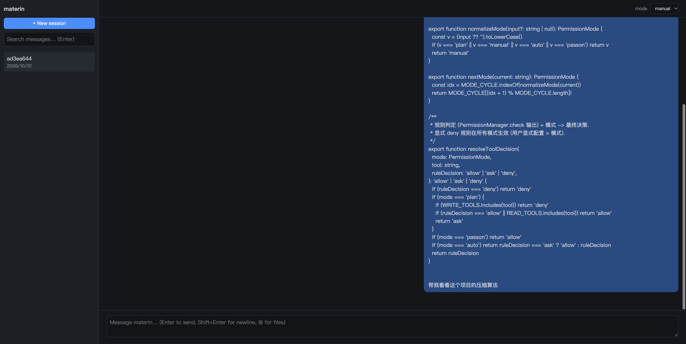
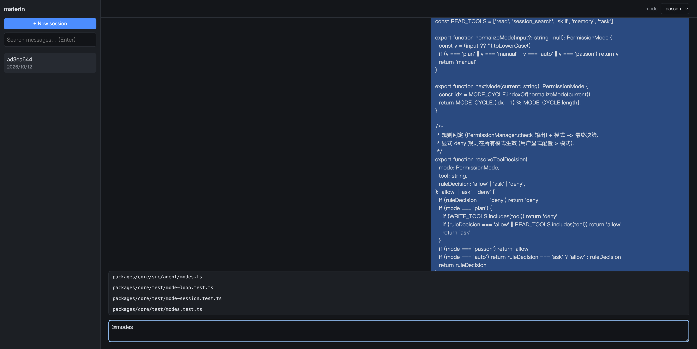
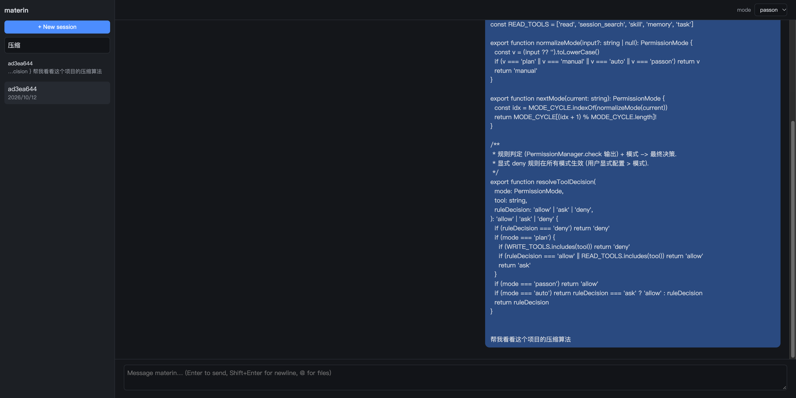

# materin 完整操作手册

> 自托管 AI Coding Agent — CLI/TUI · Web · 飞书/钉钉/企微机器人

## 1. 它是什么

```
┌─────────────────────────────────────────────────────────────┐
│                    你可以使用的三种方式                        │
│                                                             │
│   终端 TUI ──────┐                                          │
│   Web 浏览器 ────┤                                          │
│   IM 机器人 ─────┤                                          │
│        │         │                                          │
│        ▼         ▼                                          │
│  ┌─────────────────────┐     ┌──────────────────────┐      │
│  │   本地 Core Server   │────▶│  Claude / DeepSeek / │      │
│  │  agent loop·会话·工具 │◀────│  Qwen / Kimi / GLM   │      │
│  └─────────────────────┘     └──────────────────────┘      │
│        │                                                    │
│        ▼                                                    │
│   ~/.materin/ (state.db · config.json · memories/ · skills/)│
└─────────────────────────────────────────────────────────────┘
```

核心能力：读写文件、执行命令、树形会话分支、上下文压缩、跨会话中文搜索、
自维护记忆、Skill、子代理、四种审批模式、模型/思考深度随时切换。

---

## 2. 安装

### 方式一：npm（推荐，无需 Bun）

```bash
npm install -g materin
materin --version    # → materin 0.1.1
```

> npm 包内含编译好的平台二进制（macOS arm64/x64 · Linux x64/arm64 · Windows x64），
> 安装时自动选择匹配平台，用户机器不需要任何运行时。

### 方式二：Release 包

| 平台 | 文件 | 安装 |
|---|---|---|
| macOS | `materin-v*.dmg` | 双击挂载 → 拷贝 `materin` 到 `/usr/local/bin/`（或运行包内 `install.sh`） |
| macOS / Linux | `materin-v*-<平台>.tar.gz` | 解压后把三个二进制放入 PATH |
| Windows | `materin-v*-windows-x64.zip` | 解压，把 `.exe` 所在目录加入 PATH |

### 方式三：源码

```bash
git clone <repo> && cd materin-code
bun install && bun run dev
```

---

## 3. 首次配置（引导式）

第一次运行 `materin`，会自动进入配置引导：

```
$ materin

欢迎使用 materin — 需要配置一个模型 provider
选择要配置的服务 (之后也可用环境变量覆盖):
  [1] Claude (Anthropic)        (ANTHROPIC_API_KEY)
  [2] DeepSeek                  (DEEPSEEK_API_KEY)
  [3] Qwen 通义 (DashScope)      (DASHSCOPE_API_KEY)
  [4] Kimi (Moonshot)           (MOONSHOT_API_KEY)
  [5] 智谱 GLM                  (ZAI_API_KEY)
  [6] OpenAI                    (OPENAI_API_KEY)
#> 1
Claude (Anthropic) API Key: sk-ant-xxx
Base URL (回车=官方默认, 私有化部署填自己的地址): https://my-proxy.corp
默认模型 (回车=claude-sonnet-5-5):
已写入 ~/.materin/config.json (0600)
```

**私有化部署**：任何 provider 都可以自定义 Base URL（中转网关、内网 vLLM/ollama）。
配置写入 `~/.materin/config.json`，环境变量优先级更高：

| 配置项 | 环境变量 |
|---|---|
| API Key | `ANTHROPIC_API_KEY` 等（见上表） |
| Base URL | `ANTHROPIC_BASE_URL` / `DEEPSEEK_BASE_URL` / `DASHSCOPE_BASE_URL` / `MOONSHOT_BASE_URL` / `ZAI_BASE_URL` / `OPENAI_BASE_URL` |
| 默认模型 | `MATERIN_MODEL` |

重新配置：`materin config`　·　**出厂重置**：`materin reset`（只删模型配置，不动会话/记忆）
指定数据目录：`materin -d /data`（config/db/memory/skills 全部跟随）

---

## 4. 终端 TUI / CLI

### 4.1 启动与会话

```bash
cd ~/my-project && materin     # 在哪启动, 哪就是工作目录 (对齐 Claude Code)
```

```
$ materin
[materin] session a1b2c3d4 — /exit 退出, Ctrl+C 中止任务/退出
[manual] > 帮我修一下 src/api.ts 里的类型错误
⏺ read(src/api.ts)
  ⎿ ...文件内容...
⏺ edit(src/api.ts) ...
```

- 启动自动恢复**当前项目**最近会话（按目录隔离，不跨项目）；`--new` 强制新建
- **Ctrl+C**：任务运行中=中止当前任务；空闲=退出
- 一次性模式：`materin -p "帮我跑下测试并修复失败"`

### 4.2 输入语法

| 前缀 | 作用 | 示例 |
|---|---|---|
| `@路径` | 引用文件（文本注入上下文 / 图片转视觉输入） | `@src/api.ts 这个接口什么问题` |
| `@截图.png` | 图片提问 | `@shot.png 这个报错怎么回事` |
| `!命令` | 执行 shell 并把输出交给模型 | `!git diff` |
| `/命令` | 内置斜杠命令（见下表） | `/model opus` |

### 4.3 斜杠命令一览

| 命令 | 作用 |
|---|---|
| `/model <别名或id>` | 切模型：`opus` `sonnet` `haiku` `deepseek` `deepseek-r1` `qwen` `kimi` `glm`，不带参数列全部 |
| `/thinking <档位>` | 思考深度 `off/low/medium/high/xhigh`（Claude→thinking budget；OpenAI→reasoning_effort；Qwen/GLM→各自参数） |
| `/mode <模式>` | 审批模式 `plan/manual/auto/passon`（下详）；`/plan` `/passon` 为快捷方式 |
| `/compact [focus]` | 压缩上下文（长会话自动触发，可手动带重点） |
| `/new` `/exit` `/reset` | 新会话 / 退出 / 重置配置（`reset` 为启动参数） |

### 4.4 审批模式（对齐 Claude Code 权限模式）

| 模式 | 行为 | 适用场景 |
|---|---|---|
| `manual` | 危险工具逐个询问（默认） | 日常开发 |
| `auto` | 自动批准（连续重复调用仍拦截） | 信任度高的批量任务 |
| `plan` | **只读**：edit/write 直接拒绝 | 让 agent 先出方案不动代码 |
| `passon` | 直通（bypass）：全部放行 | 全自动批处理，风险自担 |

> 显式 deny 规则在所有模式生效；相同调用重复 3 次（doom-loop）自动升级询问。
> 规则配置：`MATERIN_PERMISSIONS="bash:deny;edit:ask"` 格式。

### 4.5 Skill

```bash
materin init    # 一次性迁移: 把 .claude/skills 等第三方 skill 拷贝进 materin 自己的目录
```

运行时只认 `~/.materin/skills/`（全局）与 `<项目>/.materin/skills/`（项目）。
Skill 是 agentskills.io 标准格式（SKILL.md + frontmatter），模型按需读取。

---

## 5. Web 端（GUI）

```bash
bun run server                       # 或使用 npm 版: materin-server
bun run web:build                    # 首次构建 UI
open http://127.0.0.1:4128/ui/
```

**会话与对话**：左侧会话列表 + 新建按钮；对话流式渲染；`edit` 操作显示红绿 diff。



**`@` 文件补全**：输入 `@` + 关键词即弹出项目文件匹配，方向键/点击选中（与 CLI 一致，解析在 server 层）。



**粘贴与搜索**：Composer 直接 **Cmd/Ctrl+V 粘贴图片**（截图提问）、粘贴文本文件作为附件；
左上搜索框跨会话全文检索（中文可用，FTS5 双索引）。



**审批模式**：右上角下拉直接切换 plan/manual/auto/passon，与 TUI 同一份会话状态。

---

## 6. 渠道机器人（飞书 / 钉钉 / 企业微信）

```bash
materin-gateway                 # 默认后台运行 (daemon)
materin-gateway fg              # 前台调试
materin-gateway status|logs -f|stop|restart
materin-gateway install-service # 开机自启: macOS launchd / Linux systemd
materin-gateway uninstall-service
```

| 平台 | 环境变量 | 连接方式 |
|---|---|---|
| 飞书 | `FEISHU_APP_ID` / `FEISHU_APP_SECRET` | WebSocket 长连接（免公网 IP） |
| 钉钉 | `DINGTALK_APP_KEY` / `DINGTALK_APP_SECRET` | Stream 模式 |
| 企微 | `WECOM_CORP_ID`+`SECRET`+`AGENT_ID`+`TOKEN`+`AES_KEY` | 回调 `:4190`（需公网，配 frp/ngrok） |
| 本地测试 | `MATERIN_GATEWAY_CONSOLE=1` | stdin/stdout |

- 群里 @机器人 发消息（可带图）→ agent 处理 → 结果回发到群
- 会话按群/按人路由；**渠道会话默认禁用 bash/write/edit**（远程消息不可信），
  `MATERIN_CHANNEL_PERMISSIONS` 可覆盖
- PID/日志：`<数据根>/gateway.pid` · `gateway.log`
- 详细建应用步骤：`packages/gateway/README.md`

---

## 7. 数据目录

```
~/.materin/                  ← 或 -d 指定 / MATERIN_HOME
├── config.json              # provider 配置 (0600)
├── state.db                 # 全部会话 (SQLite/WAL, 树形消息 + FTS5)
├── memories/<项目>/          # 自维护记忆 (有界, 超限逼整理)
├── skills/                  # 全局 skill
├── extensions/              # 全局扩展 (TS 文件, 热加载)
├── gateway.pid / gateway.log
└── profiles/                # (规划) 多 profile 隔离
```

---

## 8. 已知限制

- **Shift+Tab 逐键切换模式**受 Bun 上游 bug 影响（在途 SSE 流会饿死 stdin 逐键事件），
  当前用 `/mode` `/plan` `/passon` 命令切换；Bun 修复后快捷键自动生效（监听代码已就位）
- 中文全文检索：≥3 字走 FTS5 索引，1-2 字走全扫描兜底（当前量级毫秒级）
- 渠道真实连通性需各平台企业应用凭据（见 packages/gateway/README.md）
